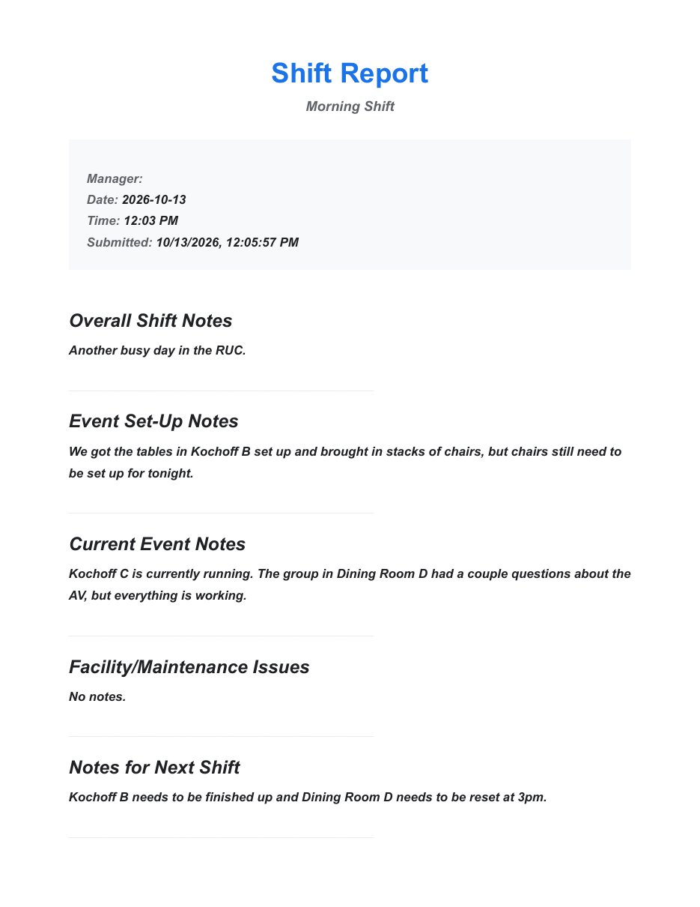
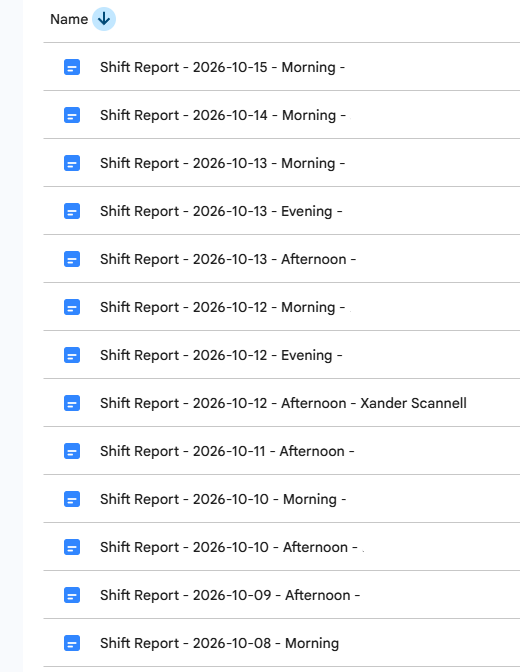
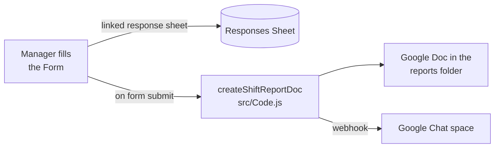
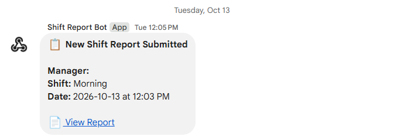
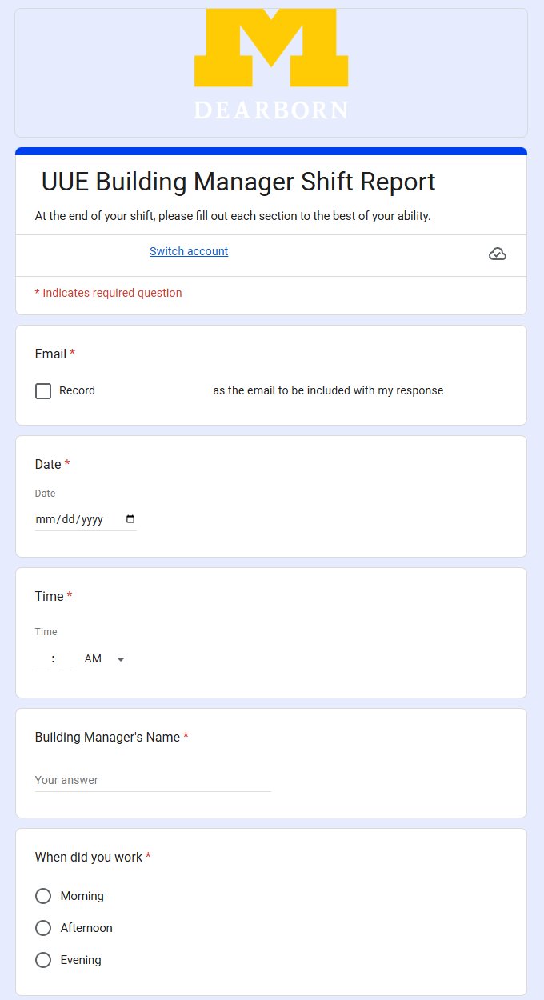
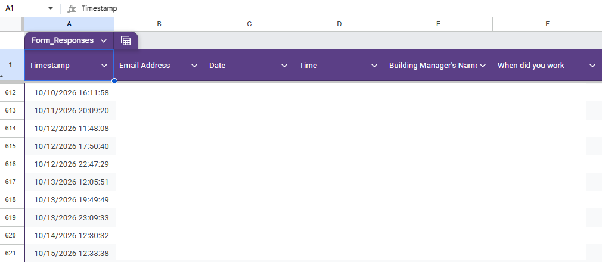

# Shift handoff

A shift-report system built on Google Workspace. At the end of a shift the manager fills in a Google Form. Each response is logged to a Sheet, turned into a formatted Google Doc, and announced in the team's Google Chat space with a link to that Doc, so the next shift can read what happened without opening a spreadsheet.

It has been in daily use since November 2025. A team of about eight managers fills it in at the end of every shift, normally three shifts a day, and it has handled 620 reports so far.

| One shift's report | Every report, filed automatically |
| :---: | :---: |
|  |  |

## How it works



1. **Form.** The manager records their name, the shift, the date and time, and notes under five headings.
2. **Sheet.** Google appends the response as a row. This is the complete log of every report.
3. **Doc.** An installable trigger runs `createShiftReportDoc`, which builds a Doc titled `Shift Report - <date> - <shift> - <manager>` with a header, an info box and one section per note heading (empty sections read "No notes provided"), then files it in a shared Drive folder.
4. **Chat.** The script posts the manager, shift, date, time and a link to the Doc to the team's Chat space through an incoming webhook.

<p align="center">
  
</p>

Only steps 3 and 4 are code. The Sheet link, the trigger and the configuration are set up in the Google UI, so they are documented below in enough detail to rebuild the system.

## Setting it up

### 1. The form

<p align="center">
  
</p>

The form also collects the respondent's email (**Settings > Responses > Collect email addresses**). That is a form setting rather than a question, so it goes to the Sheet but not into the Doc or the Chat message.

The script reads answers by question ID rather than title, so questions can be reworded without breaking it. A new or recreated question gets a new ID: run `logFormIds` (`src/logFormIds.js`) from the script editor and copy the ID it logs into `FORM_IDS` at the top of `src/Code.js`.

| `FORM_IDS` key | Question | Where it ends up |
| --- | --- | --- |
| `MANAGER_NAME` | Manager name | Doc title, info box, Chat message |
| `WHEN_WORKED` | Shift worked | Doc title, subtitle, Chat message |
| `DATE` | Date | Doc title, info box, Chat message |
| `TIME` | Time | Info box, Chat message (shown in 12-hour time) |
| `NOTES_OVERALL` | Overall shift notes | Doc section |
| `NOTES_SETUP` | Event set-up notes | Doc section |
| `NOTES_EVENT` | Current event notes | Doc section |
| `NOTES_FACILITY` | Facility/maintenance issues | Doc section |
| `NOTES_NEXT` | Notes for next shift | Doc section |

### 2. The response sheet

In the form, open **Responses > Link to Sheets**. No code is involved: Google appends one row per response, with a timestamp in column A, and adds a column whenever a question is added.

<p align="center">
  
</p>

### 3. The script

Create the script from the form (**Extensions > Apps Script**) so it is bound to it, then add the files in `src/`.

### 4. Configuration

In the script editor, under **Project Settings > Script properties**:

| Property | Value |
| --- | --- |
| `WEBHOOK_URL` | The Chat space's incoming-webhook URL (**Space settings > Apps & integrations > Webhooks**). If it is missing, the Doc is still created and the Chat message is skipped. |
| `FOLDER_ID` | The ID of the Drive folder for reports, the last part of the folder's URL. If it is missing or can't be opened, reports go to a folder named "Shift Reports" in the trigger owner's Drive, created if needed. |

Both stay out of the code: anyone with the webhook URL can post to the Chat space.

### 5. The trigger

In the script editor, under **Triggers**, add:

| Function | Event source | Event type |
| --- | --- | --- |
| `createShiftReportDoc` | From form | On form submit |

## Editing the code

The code is synced with the script editor using [clasp](https://github.com/google/clasp), logged in as the account that owns the form:

```sh
npx @google/clasp pull   # script editor -> this folder
npx @google/clasp push   # this folder -> script editor (live immediately)
```

`.clasp.json` holds the script ID and is gitignored.
